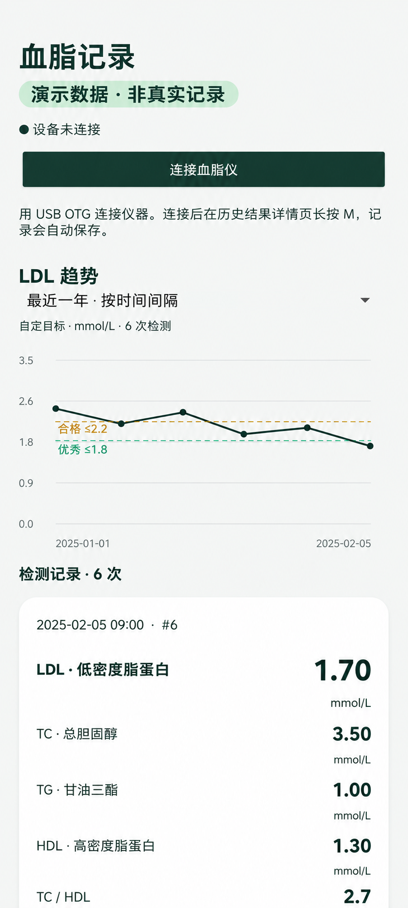

# 血脂记录 · PFS-30A

Android 本地血脂记录工具，通过 USB OTG 接收优利特 PFS-30A 的打印报告，保存检测结果并展示 LDL 趋势。

## 功能

- 按检测时间倒序展示记录，LDL 优先显示，保留单位和仪器箭头标记。
- 自动保存至应用私有 SQLite 数据库，重复报告自动去重。
- LDL 图表支持最近 52 条等距排列、全部记录按时间排列、最近一年按时间排列。
- 图中 2.2 和 1.8 mmol/L 是用户自定目标。
- 显示设备连接状态，接收后自动刷新。
- 应用无联网权限，记录存储在手机本地。

## 截图

以下为经过图像编辑的演示图，日期、曲线和检测结果均为虚构示例。



## 安装下载

在本仓库 GitHub 页面右侧打开 **Releases**，选择版本，下载附件中的 APK。首次发布需要仓库维护者配置签名并推送版本标签，详见 [发布说明](docs/RELEASING.md)。仓库源码本身不包含 APK。

需要 Android 8.0 或更高版本，以及支持 USB Host 的手机、OTG 转接头和数据线。

## 使用

1. 用 OTG 将血脂仪接到手机，打开应用并点击连接，允许 USB 访问。
2. 在仪器历史列表选择记录，进入 TC 结果详情页，长按 M 触发打印。
3. 应用自动保存并显示结果。继续在仪器上选择其他记录并打印。

目前已验证的是逐条打印接收。整机历史记录的主动批量读取协议尚未获得。

完整说明见 [使用手册](docs/USER_GUIDE.md)。

## 本地构建

安装 JDK 17 和 Android SDK 35，在 `local.properties` 中设置 `sdk.dir`，或配置 `ANDROID_HOME`。

```sh
./gradlew assembleDebug
adb install -r app/build/outputs/apk/debug/app-debug.apk
```

升级使用相同应用 ID 和签名，并递增 versionCode。覆盖安装保留数据，卸载、清除应用数据会删除记录。当前应用 ID 为 `local.pfs30a`。

## 协议与依赖

实测设备 USB ID 为 `1a86:7523`，串口参数为 115200 / 8N1，打印正文采用 GBK 编码。使用 [usb-serial-for-android](https://github.com/mik3y/usb-serial-for-android) 的 CH340 驱动（MIT License）。

## License

本项目采用 [MIT License](LICENSE)。
